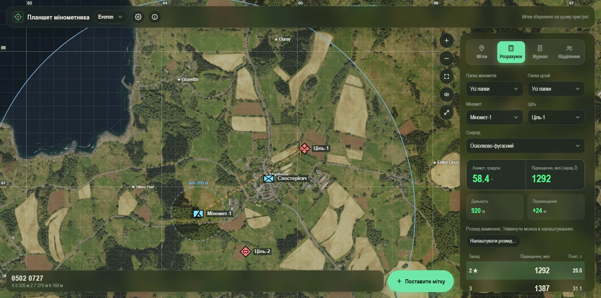

# Mortar Tablet

**Instant mortar fire calculation for Arma Reforger: right on the map, in the browser and on your phone.**

Place a mortar, place a target, and within a second you get the azimuth in mils, the elevation, the charge and the time of flight,
with the height difference taken into account. No tables, notebook or calculator: you look at the map instead of doing arithmetic.

**[Open the web version](https://ingwalde.github.io/mortar-tablet/)** (runs in the browser; on a phone it can be installed as an app)



## Why it is convenient

- **The map at hand.** Everon, Arland, Kolguyev and the maps of popular mods (Gogland, Bad Orb, Bystrany, Kirovograd, Mogadishu, Iron Hold Castle, Novyinovka): zoom, a coordinate grid, place names, building outlines.
- **Clear symbols.** Marks are friend (blue rectangle) or hostile (red diamond) and come as infantry, armour, mortar, helicopter or a retreat cross, each with a caption you can write and a legend (the "?" button on the "Marks" tab).
- **Aiming with one tap.** Tap a building and the reticle snaps to it; "Place mark" puts a target exactly at the centre. Destroyed targets are marked on the map. A selected mark can be dragged on the map with the mouse or a finger.
- **Real ballistics.** M252 and 2B14, high-explosive, illumination and smoke shells, the best charge (★), height correction, time of flight.
- **Safety warning.** If a friendly mark lies within the dispersion plus the fragmentation range of the shell (taken from the game files) around the target, the solution and the firing log show a warning that does not block aiming.
- **See where it lands.** Range rings, the line of fire, a dispersion ellipse; a shot with flight animation, a rumble and an impact at the moment of arrival.
- **Squad mode.** A shared live map: the commander creates a squad, the others join by a link or QR code. Roles (commander, mortarman, soldier) decide who can place and change what; everyone sees every mark with its author, mortarmen and the commander also share the firing log, and when the game is over the commander gets a report (statistics, who marked what and when) that can be edited, saved as a file or a printable page and opened later. It needs internet and a small relay server ([`server/`](server/README.md)); the data is deleted when the report is saved, a day after the game, or after three days without activity.
- **Together with your crew.** Share markers by link, QR code or file, keep a firing log.
- **Comfortable on a phone.** Three dark themes, a light mode for weak devices, vibration, the screen stays on.
- **Free for the community.** No ads and no registration; the source code is available for noncommercial use, modification and distribution.

## Downloads

Ready-made builds are on the [releases page](https://github.com/Ingwalde/mortar-tablet/releases) and on the
[download page](https://ingwalde.github.io/mortar-tablet/download.html) (English and Ukrainian, chosen by the browser language).

| Platform | File | Updates |
| --- | --- | --- |
| Web / iPhone | [the web version](https://ingwalde.github.io/mortar-tablet/) (add it to the home screen) | automatic |
| Windows | `MortarTablet-Setup-<version>.exe` (installer) or `MortarTablet-<version>-portable.exe` | the installer updates itself; the portable build does not |
| macOS | `MortarTablet-<version>-mac-arm64.dmg` (Apple Silicon) or `...-mac-x64.dmg` (Intel) | the app tells you when a new version is out |
| Linux (x64) | `MortarTablet-<version>-linux-x86_64.AppImage` or `...-linux-amd64.deb` | the AppImage updates itself; for the .deb the app tells you when a new version is out |
| Android | `MortarTablet-<version>.apk` (the maps are inside, no internet needed) | the app tells you when a new version is out |

The Windows and macOS builds are not code-signed: Windows SmartScreen asks for confirmation ("More info" → "Run anyway"), and on macOS you open
the app with right-click → "Open". macOS cannot update an unsigned app by itself, which is why it only reports new versions.
Download files only from this repository's releases. The Windows installer asks for the language (Ukrainian or English), installs for the current user without administrator rights and lets you choose the program folder and the folder for downloaded maps. The web version has a separate "Download the app" button at the top that opens this page.

## Development

```bash
npm install
npm run dev
```

Opens an Electron window with hot reload. The renderer logs are mirrored to the main process console.

### Tests and checks

```bash
npm test          # vitest run (ballistics, geometry, tiles, heights, documentation checks)
npm run typecheck # tsc --noEmit for main/preload and renderer/core
npm run check     # typecheck + tests + pack + a smoke test of the packaged app
```

`scripts/check-places-local.mjs` and `scripts/test-import-module.mjs` are helper scripts for checking the map calibration and the sharp tile pyramid
by hand on real files (they need `maps/<terrain>_sat_*.png` in the project root).

### Builds

```bash
npm run pack        # only the unpacked app (dist/win-unpacked)
npm run dist:setup  # only the NSIS installer
npm run dist:win    # NSIS installer + portable .exe -> dist/
npm run dist:mac    # dmg (needs macOS)
npm run dist:linux  # AppImage + deb
npm run build:web   # the standalone web version (PWA) -> out/web
```

- The `master` branch is protected: changes go in through pull requests, and the workflow `Check` (`.github/workflows/check.yml`: types, tests and the documentation test) must pass before a pull request is merged.
- `npm run check` is enough before a release; the full build is only needed for publishing. Antivirus software slows packaging down a lot
  (thousands of small files): add the project's `dist` and `node_modules` folders to the Windows Defender exclusions.
- **Windows, `winCodeSign` error:** if the build fails with `Cannot create symbolic link` while downloading `winCodeSign`, turn on Developer Mode
  (Settings → Privacy & security → For developers). It is needed only on the machine that builds; it has no effect on the finished `.exe` for end users.
- macOS and Linux builds are made on GitHub Actions (workflow `Desktop`, started manually) because they need those systems; the Android APK is built by the workflow `Android`;
  the site is published by the workflow `Pages`. Giving a tag to `Desktop` or `Android` attaches the files to that release.
- A release consists of: the version in `package.json` (and `package-lock.json`), the tag `v<version>`, the Windows files (including `latest.yml` and the `.blockmap`
  for automatic updates), the files of the `Desktop` and `Android` workflows (`latest-linux.yml` too) and the native-library source archive
  (see [Native libraries](#native-libraries)).

## Map without internet (PC)

On the PC the cloud button in the header ("Offline mode") saves the online tiles of Everon, Arland and Kolguyev to disk, so the map works without internet.
Imported maps are already on disk.

**Where the files go.** Downloaded tiles, imported maps and heights can take several gigabytes. The Windows installer asks for a folder for them (the default is the app's data folder), and later it can be changed in Settings → "Maps and data" → "Open manager" → "Change folder…": the files are moved to the new folder. The choice is kept in `data-dir.txt` in the app's data folder; marks and the log always stay there.

## Standalone version (no PC)

The same app built as a PWA (`npm run build:web` → `out/web`): it works on a phone or in any browser without a PC.
Markers and the log live in the browser storage of the device; exchange is by file ("Export…" / "Import…" on the "Marks" tab) or by link/QR.
Heights are built in; the Everon/Arland/Kolguyev map tiles are loaded straight from their original source (internet needed) and are not copied to the site.
The mod maps are on the site. Importing your own maps is only possible in the PC app.

- Publishing: the workflow `.github/workflows/pages.yml` (GitHub Pages), started manually or by a push to master that changes the site.
- Locally: `WEB_SKIP_MOD_MAPS=1 npm run build:web` (without the mod maps, fast), then any static server on `out/web`.
- What exactly is on the site (mod maps, heights) is described in `src/core/webMirror.ts`; downloaded files are cached in `.web-cache/`.

### Sharing markers by link and QR

"Export…" on the "Marks" tab offers "Copy link" and "Show QR". The markers are compressed and put into the address fragment
(`<site>#s=…`), so the server never sees them. A phone points its camera at the QR, the web version opens, and the import is offered automatically (the map is switched if needed).
A link can also be pasted into the "Import…" field ("Paste from clipboard"). Very large sets do not fit into a QR: then use the link or a file.
The format and the checks are in `src/core/shareLink.ts`.

Note for iPhone: a link opens in Safari, while an app added to the home screen has separate storage; in that case copy the link and paste it into "Import…" inside the app.

### Shot and impact sound

The sound is synthesised with WebAudio. Most of the energy of a shot and an impact lies in the bass that phone speakers do not reproduce, so rumble harmonics and
mid-frequency layers are added. To check without speakers: open the site with `?audiotest=1` and run `await __mortarAudioTest(6)` in the console (renders into a buffer).

### Destroyed buildings

A target or point can be marked as destroyed (✕ in the list or a checkbox in the dialog). If the marker stands on a building (or right next to it, up to 3 m from a wall),
that building turns red on the map together with the annexes that touch it, labelled "Destroyed" in the middle of the main block; without a building outline a red circle is drawn.
A tap on the red building selects the marker, and the state can be changed or restored with the same ✕/↺ or in "Edit". The outlines come from the `.topo` files of worlds and mods (the BULD section):
`node scripts/extract-buildings.mjs <id> <file.topo> <size, m> src/core/buildings/<id>.ts`; there is no data for Iron Hold Castle.

### Settings

The ⚙ button in the header opens the settings screen with sections and a search (on a phone the sections are a strip at the top). "Reset section" restores the defaults of a section.

- **Appearance:** theme (green/red/blue), language, place names (shown, size, importance), range rings, light mode.
- **Sound and feedback:** shot sound (the speaker button on the map remains), volume, a sound test, vibration on a shot, "keep the screen on" (phone and site).
- **Calculation:** shell dispersion; available and default shells for each mortar (disabled ones are not offered in the "Shell" list, the default is selected when a mortar is chosen). Charges are not configurable: the charge is picked automatically (★).
- **Maps and data** (the map, coordinate calibration, the manager of downloaded data: PC app only), **Backups**, **Updates and about** (new version notices: site, Android and macOS/Linux).

Device settings (theme, sound, vibration and so on) are kept on the device. The shell selection logic is in `src/core/settings.ts`, the screen in `src/renderer/settingsPanel.ts`.

### Aiming at a building and colour themes

A tap on a building aims the reticle at its centre; the building under the reticle is highlighted, and "Place mark" puts a target exactly at the centre and names it after the nearest
settlement ("Montignac: Target 1", a place within 500 m). The theme is chosen in settings (⚙ → "Appearance"): green (default), red and blue. All three themes are always dark (the system light/dark theme is not used); red and blue are built like green:
the same tone relations, only a different hue. Marker colours, the grid and the map itself stay as they are. The choice is stored on the device.

### Downloaded data and higher resolution

- **PC:** ⚙ → "Maps and data" → "Downloaded data" → "Open manager": the online tile cache, imported maps and heights for each terrain with sizes and delete buttons.
- **Site (PWA):** there is no offline map mode: the Everon/Arland/Kolguyev tiles come from the original source and are not stored on the site. Offline saving of the map tiles exists only in the PC app.
- **Novyinovka** ships with the PC app (`resources/maps/novyinovka`, a full 8192 px pyramid), on the site and in the APK; your own import takes priority.

### Shell dispersion

⚙ → "Calculation" → "Shell dispersion": a switch, the mode "from the game data" or two numbers (% of the range), along the line of fire and across it, separately for M252 and 2B14.
The "Solution" tab keeps a short summary of the radii and a button to the settings.
An ellipse is drawn around the target on the map (the major axis along the fire); the radii are also shown in metres. The ballistic tables have no dispersion,
so the user sets the values; it is off by default. The calculations are in `src/core/spread.ts`.

### Update notices

Web version: when the service worker has downloaded a new build, "Update" appears at the top. The Android app checks the latest release on GitHub twice a day and offers to download the APK.
On the PC, Windows (installer) and Linux (AppImage) download and install updates by themselves; macOS and the .deb package check the latest release and offer to open the download page.

## Security

The renderer is sandboxed with a CSP, IPC is validated, and the dangerous Electron modes are turned off in the build. Details and known limitations: [SECURITY.md](SECURITY.md).
A check of the built app: `npm run smoke` (also part of `npm run check`).

## Application data

Markers, settings, the tile cache and the height data are stored in the application's user-data folder
(`%APPDATA%/mortar-tablet` on Windows; the per-user application-data folders of macOS and Linux), not in localStorage.

## License

The authored parts of the application are under the [Mortar Tablet Noncommercial License 1.0](LICENSE).
Free noncommercial use, modification and distribution are allowed, including in gaming communities and Discord. Selling, paid access, advertising, sponsorship
monetisation and inclusion in commercial products or paid services need the author's separate written permission. The full terms are in the LICENSE file.

This is a license with a noncommercial restriction, not an open-source license.
It does not change the licenses of third-party code, libraries, maps and data, and it does not revoke
the rights to earlier copies already received under the MIT license. The license change itself
grants no additional rights to third-party materials and no permission to publish in app stores.

### Data source licenses

Notices for third-party materials: [THIRD-PARTY-NOTICES.md](THIRD-PARTY-NOTICES.md).
The application license and these notices are available in "About" → "Licenses and credits".

- [EnfusionMapMaker](https://github.com/nickludlam/EnfusionMapMaker) (nickludlam), APL-SA: Everon/Arland place names, the online tile scheme.
  The corresponding Everon/Arland records in `src/core/terrains-data.json` stay under APL-SA: noncommercial and for Arma only.
  The rest of the file contains data from other sources; the license of the authored code does not change that.
- [GeNeFRAG/ArmaReforger](https://github.com/GeNeFRAG/ArmaReforger): code under MIT; the source of the tables, the terrain catalogue and the links to maps and heights.
  The repository's MIT license does not confirm rights to the original sources of all images and data.

Documents in [`legal/`](legal): the release review status ([RELEASE-REVIEW.md](legal/RELEASE-REVIEW.md)), the origin of the maps
([ASSET-PROVENANCE.md](legal/ASSET-PROVENANCE.md)) and the requirements for the native libraries ([NATIVE-COMPONENTS.md](legal/NATIVE-COMPONENTS.md)).
`npm run licenses:collect` gathers the notices of the installed runtime dependencies; the npm build commands run it automatically.

A noncommercial project, not affiliated with Bohemia Interactive.

### Native libraries

The desktop builds use the libvips image library through sharp (LGPL and other licenses). Their license texts, the written offer of the source code and
the instructions for rebuilding and replacing the library are in [`legal/native/`](legal/native): [SOURCE-OFFER.md](legal/native/SOURCE-OFFER.md) and
[REBUILD-LIBVIPS.md](legal/native/REBUILD-LIBVIPS.md). The source archive for a release is produced by `node scripts/collect-native-sources.mjs`
and attached to that release.

## Map tile format

Imported maps are cut into **WebP** tiles (JPEG before): the files are a third to a half smaller at the same quality. Old JPEG pyramids work as they are; to convert them to WebP,
close the app and run `node scripts/convert-pyramids-webp.mjs` (`--keep` keeps the originals, `--only=bystrany,mogadishu` limits the set of maps).

## Documentation

Design documents are in [`docs/`](docs): the plan for the squad mode is [docs/squad-mode.md](docs/squad-mode.md).

All documentation is written in English, and this README is kept in step with the code: the test `test/docs.test.ts` (part of `npm test`) fails if the README mentions
an npm script, a script file, a workflow or a document that does not exist, contains a hard-coded version number, or if any documentation file is not in English.
When you change a command, a build or a platform, change this README in the same commit.
